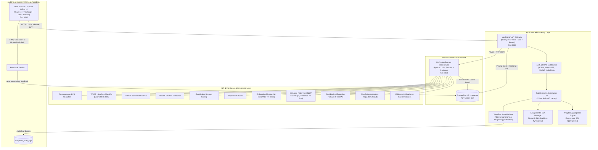

# System Architecture Specification (Phase 3: Production Hardening, Analytics & Operations)

**Project Title:** Intelligent Customer Complaint Analysis and Automatic Resolution Recommendation
**Academic Level:** MCA Final-Year Capstone Project
**Document Phase:** Phase 3 — Production Hardening, Operational Analytics & Intelligent Operations

---

## 1. Executive Architecture Overview

The system is architected as a modular, decoupled monorepo designed to solve customer support triage, classification, and evidence-grounded resolution challenges. The architecture ensures strict separation of concerns across the user presentation layer, the transactional business layer, the analytical machine learning microservice, and a relational/vector storage engine.

In Phase 3, the architecture is hardened with enterprise security, role-based authorization, dynamic SLA monitoring, a workflow state machine with full chronological auditing, real database-aggregated analytics, and structured recommendation quality evaluation.

### Phase 3 End-to-End Architecture Topology

---

## 2. Core Service Boundaries & Responsibilities

| Service | Primary Technology | Responsibility | Port | Network Exposure |
| :--- | :--- | :--- | :--- | :--- |
| **Web Frontend** (`apps/web`) | React 18, Vite, TypeScript, Tailwind CSS, Lucide, Recharts | Role-appropriate UI, real-time analytics dashboard, complaint queue, SLA countdowns, assignment modal, recommendation panel with 3-way feedback, knowledge base catalog. | `3000` | Public / Browser |
| **Application API** (`services/api`) | Node.js 24, Express, TypeScript, Zod, Prisma, bcryptjs, jsonwebtoken | System orchestrator, RBAC authorization, state machine validation, transactional CRUD, internal NLP client, feedback recording, SLA tracking, audit logging. | `5000` | Public / Client |
| **NLP Microservice** (`services/nlp`) | Python 3.12, FastAPI, PyTorch, SentenceTransformers, scikit-learn | Multi-task NLP classification, 384-d embedding pipeline, semantic vector search, evidence-grounded RAG resolution generation, risk rules heuristics. | `8000` | Internal Service Network Only |
| **Database** (`docker-compose`) | PostgreSQL 16 with `pgvector` v0.8.7 extension | Relational state storage (complaints, users, audit logs, departments, recommendations, feedback) + 384-d HNSW vector index (`vector_cosine_ops`). | `5434` (host) | Internal / Docker Network |

---

## 3. Security & Role-Based Access Control (RBAC)

The system implements strict server-side authorization:

1. **Authentication:** Stateless JSON Web Tokens (JWT) signed with HMAC-SHA256 containing `userId`, `email`, `role`, and `fullName`. Tokens expire after 24 hours.
2. **Password Hashing:** Passwords hashed with `bcryptjs` using a cost factor of 10. Passwords and hashes are never exposed in responses or logs.
3. **Role Hierarchy:**
   - `ADMIN`: Full administrative control, user registration, system health diagnostics.
   - `MANAGER`: Complaint assignment, reassignment, reopen justification review, full analytics access.
   - `AGENT`: Assigned complaint investigation, status progression (`IN_REVIEW`, `RESOLVED`), recommendation generation, feedback submission.
   - `AUDITOR`: Strictly read-only access. Mutation endpoints reject auditor requests with `403 FORBIDDEN`.
4. **Least-Privilege Enforcement:** Route handlers declare required roles using `requireRoles(...)` middleware. Unauthorized actions are intercepted before touching business logic.
5. **Rate Limiting:** Protects sensitive endpoints (e.g. login, registration) against brute-force attacks via `express-rate-limit` (100 requests per 15-minute window).

---

## 4. Complaint Workflow State Machine

The complaint lifecycle progresses through explicit, validated states:

$$\text{PENDING} \xrightarrow{\text{NLP Analysis}} \text{ANALYZED} \xrightarrow{\text{Agent Takeover}} \text{IN\_REVIEW} \xrightarrow{\text{Resolution Confirmed}} \text{RESOLVED}$$

- **Valid Forward Transitions:**
  - `PENDING` $\rightarrow$ `ANALYZED`, `IN_REVIEW`, `DISMISSED`
  - `ANALYZED` $\rightarrow$ `IN_REVIEW`, `DISMISSED`
  - `IN_REVIEW` $\rightarrow$ `RESOLVED`, `DISMISSED`
- **Reopening Verification:** Reopening a complaint from `RESOLVED` or `DISMISSED` back to `IN_REVIEW` or `PENDING` requires explicit justification recorded in the audit log. Unjustified reopening attempts are rejected with `400 REOPEN_REASON_REQUIRED`.
- **Chronological Auditing:** Every state change, assignment, reassignment, and NLP analysis emits an immutable record in `complaint_audit_logs` capturing `fromStatus`, `toStatus`, `action`, `reason`, `actorId`, `actorName`, and timestamp.

---

## 5. Dynamic SLA Deadline Calculation

SLA deadlines are dynamically established upon NLP analysis based on the computed urgency level:

$$\text{SLA Deadline} = \text{Analysis Timestamp} + \Delta t_{\text{urgency}}$$

| Urgency Level | Maximum Resolution SLA ($\Delta t$) | Rationale |
| :--- | :---: | :--- |
| **CRITICAL** | **24 hours** | Severe regulatory threat, active fraud, or imminent legal exposure. |
| **HIGH** | **48 hours** | Direct financial loss, double billing, or unauthorized debit. |
| **MEDIUM** | **120 hours (5 days)** | Standard billing discrepancy or credit reporting dispute. |
| **LOW** | **240 hours (10 days)** | General inquiry, informational clarification, or documentation request. |

Complaints exceeding their deadline are automatically flagged as `isOverdue: true` across list queries and dashboard metrics.

---

## 6. Real Operational Analytics Engine

The analytics module executes server-side SQL queries over real PostgreSQL records:

1. **Volume Metrics:** Total complaints, new complaints in period, open vs resolved ratio, volume by product category, volume by department, volume by submission channel.
2. **Operational Performance:** Average and median time to first assignment, average and median time to resolution, active department backlog, overdue count, and reassignment rate.
3. **AI Performance:** Category and urgency distributions, human-review rate, recommendation generation rate, feedback acceptance/modification/rejection rates, and 6-dimension evaluation rubric averages.
4. **Denominator Transparency:** Every reported metric includes its mathematical formula and explicit denominator.
5. **Zero Division Safeguard:** Empty datasets return `null` with formatted `"N/A"` labels rather than fabricating zeros or crashing.

---

## 7. Knowledge Base Provenance & RAG Grounding

1. **Provenance Fields:** Every resolution entry tracks `source_title`, `source_url`, `source_org`, `content_type`, `version`, `effective_date`, `last_verified_at`, and `statutory_authority`.
2. **Distinction of Content Types:**
   - `STATUTORY_PLAYBOOK`: Official regulatory dispute procedure (Reg Z, FCRA, Reg E, RESPA, FDCPA).
   - `OPERATIONAL_SOP`: Internal institutional standard operating procedure.
   - `SYNTHETIC_FIXTURE`: Edge-case testing record (`is_verified: false`), excluded from production RAG.
3. **Evidence-Grounded RAG Engine:** Offline extractive provider synthesizes action steps strictly from retrieved precedents, citing statutory authorities with similarity thresholds.
4. **3-Way Feedback & Evaluation Rubric:** Support officers record whether recommendations were `ACCEPTED_AS_IS`, `MODIFIED`, or `REJECTED`, and score recommendations across 6 rubric dimensions (Relevance, Grounding, Citation, Actionability, Safety, Escalation).
