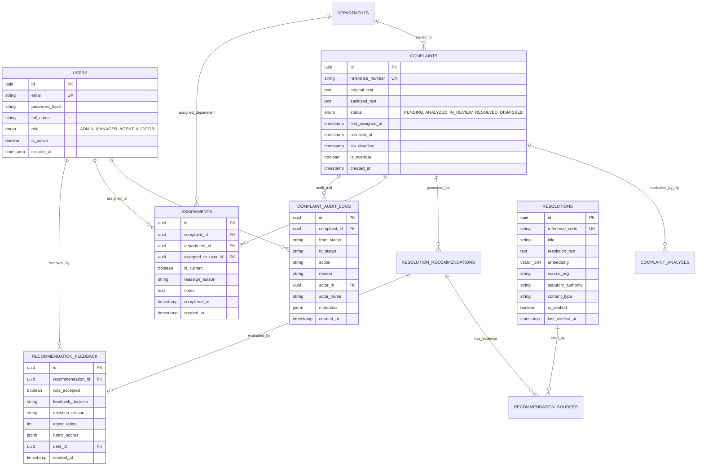

# Database Design & Vector Infrastructure (Phase 3)

**Project Title:** Intelligent Customer Complaint Analysis and Automatic Resolution Recommendation
**Database Engine:** PostgreSQL 16 with `pgvector` Extension (v0.8.7)
**ORM / Migration Engine:** Prisma ORM (v6.4.1)
**Vector Embedding Model:** `sentence-transformers/all-MiniLM-L6-v2` (384 Dimensions, L2-normalized)
**Index Type:** HNSW (Hierarchical Navigable Small World) with `vector_cosine_ops`

---

## 1. Database Architecture & Vector Strategy

### 1.1 Native pgvector vs. Plain JSON Arrays

Customer complaint triage systems that recommend resolutions require fast nearest-neighbor semantic search over historical dispute resolutions and standard operating procedures (SOPs).

Storing vector embeddings as ordinary JSON arrays (`float[]` or `jsonb`) in relational databases introduces critical performance limitations:
1. **No Index Acceleration:** Plain JSON arrays cannot use Hierarchical Navigable Small World (HNSW) or Inverted File Flat (IVFFlat) indices.
2. **High Query Latency:** Calculating cosine distance across millions of dimensions requires full table scans with high CPU overhead ($O(N \cdot D)$).
3. **Memory Waste:** JSON strings require serializing and deserializing arrays on every query.

**Selected Strategy: Native PostgreSQL `pgvector`.**
- Extension: `vector` enabled via migration (`CREATE EXTENSION IF NOT EXISTS "vector";`).
- Data Type: Native `vector(384)` matching the `all-MiniLM-L6-v2` embedding model dimension.
- Index Method: HNSW cosine distance index (`vector_cosine_ops`) for sub-millisecond retrieval with logarithmic search complexity ($O(\log N)$).

```sql
CREATE INDEX IF NOT EXISTS "resolutions_embedding_hnsw_idx"
ON "resolutions"
USING hnsw ("embedding" vector_cosine_ops);
```

### 1.2 Prisma Integration Strategy & Cosine Similarity Queries

Prisma ORM provides relational schema modeling, migrations, and type-safe query builders. However, Prisma has specific architectural constraints when handling vector search:
- **Prisma Schema Support:** The vector column is defined as `Unsupported("vector(384)")?`.
- **Vector Search Limitation:** Prisma's standard query builder does not natively support vector distance operators (such as cosine distance `<=>`).
- **Hybrid Solution:** Relational workflows and foreign-key joins use Prisma Client methods (`prisma.complaint.findUnique`, `prisma.resolutionRecommendation.create`), while semantic vector retrieval is executed via parameterized SQL with cosine distance calculations:

```sql
SELECT
    id, reference_code, title, complaint_text, resolution_text, resolution_outcome,
    category, department_code, is_verified, verification_status, data_source,
    1.0 - (embedding <=> $1::vector) AS similarity_score
FROM resolutions
WHERE is_verified = TRUE
  AND embedding IS NOT NULL
  AND (1.0 - (embedding <=> $1::vector)) >= $2
ORDER BY similarity_score DESC
LIMIT $3;
```

---

## 2. Implemented Schema Migrations

### 2.1 Phase 0 Migration: `20261015172442_init_pgvector_and_health_check`
- Enables `vector` extension.
- Creates `system_health_checks` verification table.

### 2.2 Phase 1 Migration: `20261016080512_phase1_complaint_intelligence`
- Creates `departments` table (canonical codes: `DEPT_CARDS`, `DEPT_CREDIT`, `DEPT_COLLECTIONS`, `DEPT_LOANS`, `DEPT_BANKING`, `DEPT_GENERAL`).
- Creates `complaints` table (reference number format `CMP-YYYYMMDD-XXXX`, status lifecycle: `PENDING`, `ANALYZED`, `IN_REVIEW`, `RESOLVED`, `DISMISSED`).
- Creates `complaint_analyses` table (predicted category, confidence, sentiment polarity, Plutchik dominant emotion, explainable urgency score, human review flag).

### 2.3 Phase 2 Migration: `20261016135546_phase2_rag_resolutions`
- Creates `resolutions` table with native `vector(384)` embedding column and HNSW index.
- Creates `resolution_recommendations` table (suggested steps, grounded rationale, heuristic evidence strength tier, retrieval similarity score, human review triggers).
- Creates `recommendation_sources` junction table (provenance links to cited `resolutions`, cosine similarity score, citation rank).
- Creates `recommendation_feedback` table (agent acceptance, modifications, 1-5 rating, notes).
- Creates `assignments` table (department/agent routing audit trail).

### 2.4 Phase 3 Migration: `20261017085116_phase3_auth_workflow_analytics`
- Creates `users` table: RBAC accounts with bcrypt password hashes, full names, roles (`ADMIN`, `MANAGER`, `AGENT`, `AUDITOR`), and active status.
- Creates `complaint_audit_logs` table: Immutable chronological audit trail recording `fromStatus`, `toStatus`, `action`, `reason`, `actorId`, `actorName`, and JSON metadata.
- Enhances `complaints`: Adds `firstAssignedAt`, `resolvedAt`, `slaDeadline`, and `isOverdue` columns.
- Enhances `assignments`: Adds `isCurrent`, `reassignReason`, `completedAt`, and `assignedToUserId` foreign key to `users`.
- Enhances `resolutions`: Adds provenance tracking (`sourceTitle`, `sourceUrl`, `sourceOrg`, `contentType`, `version`, `effectiveDate`, `lastVerifiedAt`, `statutoryAuthority`).
- Enhances `recommendation_feedback`: Adds 3-way decision (`feedbackDecision`), `rejectionReason`, `userId`, and structured `rubricScores` JSON.

---

## 3. Entity Relationship Diagram (Phase 3 Monorepo)


